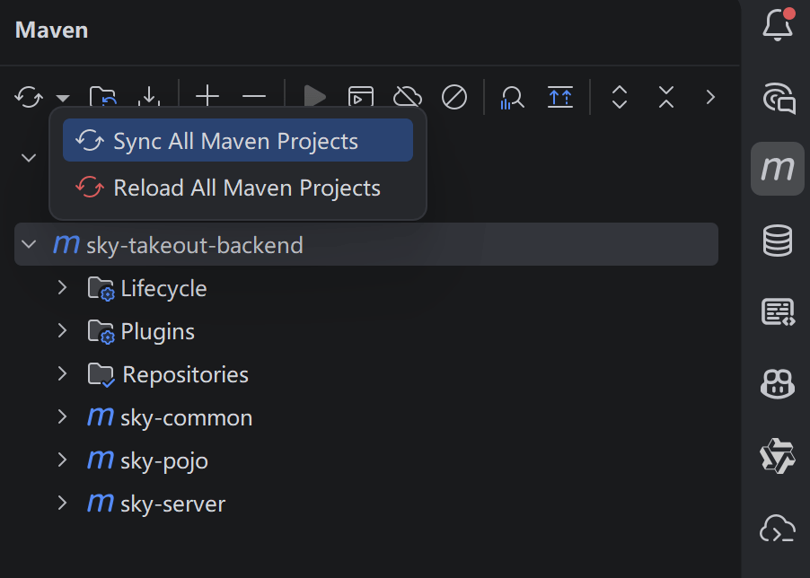
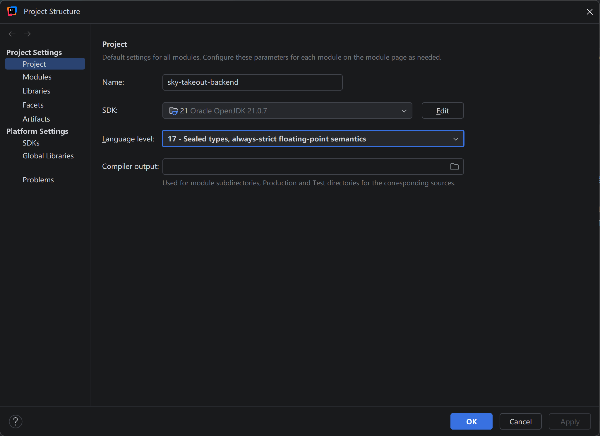
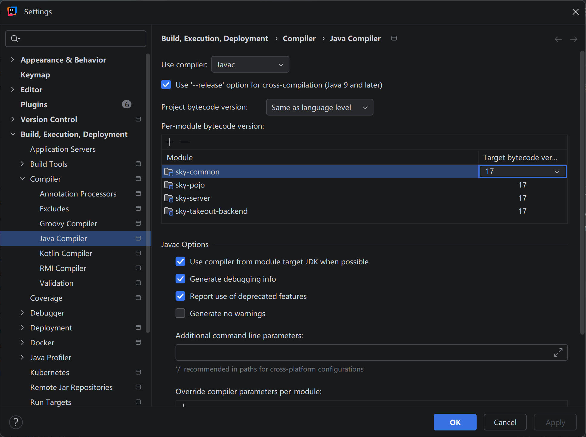

# 苍穹外卖后端

---

<h2>仓库说明</h2>

* 本仓库为黑马程序员苍穹外卖后端仓库, 仅供学习参考

### 友情链接

* [黑马哔站教程](https://www.bilibili.com/video/BV1TP411v7v6/?share_source=copy_web&vd_source=043cbf9fed7a1099cc00e49137e0ff99)
* [黑马百度网盘资料](https://pan.baidu.com/s/1MNDzXyVlr3mtmLgBjcPJVw?pwd=6633)
* [前辈的在线讲义网站](https://mouday.github.io/java-cqwm/)
* [个人博客仓库](https://github.com/existed-name/Personal-Blogs)

### 项目仓库总览

* [后端](https://github.com/existed-name/sky-takeout-backend), 本仓库、已部署
* [管理端 Web 前端](https://github.com/existed-name/sky-takeout-frontend-admin), 已部署, 可通过网址 http://39.105.17.19:80 访问( 教程的图片 URL 失效了, 去网上截的图装进来...)
  - 账号有 `admin`/`mooncake`/`xiaoshuai` 等等, 密码都是 `123456`
* [用户端小程序](https://github.com/existed-name/sky-takeout-miniprogram)
* [用户端 Web 前端](https://github.com/existed-name/sky-takeout-frontend-user), 已部署, 可通过网址 http://39.105.17.19:8082 访问, 无需密码
* 备注：后端请求路径、请求参数是自己写的，跟教程给的前端接不上，所以这里专门给前端做了同步、再发出来

<h3>跑通说明</h3>

1. 如果需要二次开发，就 fork 到自己账号、然后拉下来
    * 否则直接拉下本仓库即可 `git clone https://github.com/existed-name/sky-takeout-backend.git`
2. 拉下来过后，注意看项目文件夹 `sky-takeout-backend` 是不是被标记成了 Maven 模块
   * 比如 IDEA 右侧侧边栏，Maven 面板应该显示了完整父模块、子模块，并且这个文件夹名字会加粗
   * 不是的话就右键它 `Add as maven module`
   * 不过通常 IDEA 会识别项目根目录的 pom.xml 然后自动标记 Maven 模块
3. IDEA 右侧侧边栏，Maven 面板，`Sync all projects`

    

4. IDEA 菜单栏 → File → Project Structure → Project → SDK 设为自己本地的 JDK → Language level 选择 17，因为教程基础结构是 JDK17

    

5. IDEA 菜单栏 → File → Settings → Build → Compiler → Java Compiler → 把所有模块的目 target 字节码版本设为 17
    * 我之前老是会出现多次启动后恢复 JDK21 导致启动失败的情况，给 [pom.xml](pom.xml) 指定 `maven-compiler-plugin` 的编译版本就固定为 JDK17 了
    * 拉下来后 IDEA 应该会自动识别为 JDK17

    

6. 拿着[数据库迁移文件](/db/sky.sql)在本地数据库建表，这些表结构已经同步了我部署用的表结构，然后里面有一些教程附带的资料
7. IDEA 上面的菜单栏 → Build → Build Project，先看看能不能构建成功
8. 然后去[启动类](sky-server/src/main/java/com/sky/SkyApplication.java)启动项目
9. 前端项目的 README 或者 CLAUDE 文档里面写了怎么启动

### 部署说明

* 后端、管理端前端、用户端前端均有部署文件( Dockerfile )
* 整个项目的编排放在了管理端前端仓库的 `deploy` 文件夹( 本来该放在这边, 但是偷懒就让 ai 一起放在另一边了 ), 里面的 `README` 讲了本地部署、云部署步骤、容器结构, 可以作为参考
* 如果想试一下云服务器可以参考这篇博客 → [开通阿里云服务器+云部署](https://github.com/existed-name/Personal-Blogs/blob/main/%E6%8A%80%E6%9C%AF%E6%95%99%E7%A8%8B%E7%B1%BB/%E4%BA%91%E6%9C%8D%E5%8A%A1/%E4%BA%91%E6%9C%8D%E5%8A%A1%E5%99%A8/%E5%BC%80%E9%80%9A%E9%98%BF%E9%87%8C%E4%BA%91%E6%9C%8D%E5%8A%A1%E5%99%A8%E5%B9%B6%E8%BF%9B%E8%A1%8C%E7%AE%80%E5%8D%95%E7%9A%84%E9%83%A8%E7%BD%B2.md)

### 其他说明

* 商家地址 `北京市海淀区上地十街 10号(也就是百度大厦)`, 忘了给用户端前端首页做同步展示, 不过商家地址写进了后端异常信息, 下单时如果距离太远可以看到详细说明
* [CLAUDE.md](/CLAUDE.md)是 AI 写的, 可供二次开发参考, 里面放了后端项目结构、基础设施说明
* 正在写[后端技术点总结](/docs/后端技术点总结.md)、之后上传...

<h2>对比教程</h2>

* 主要体现在规范、性能、安全
* 整理了 2 天，详见[我和教程的实现对比](docs/我的实现对比教程实现.md)
* 这样看来，其实也不需要专门的[后端技术点总结](/docs/后端技术点总结.md), 直接看实现对比就行了，然后完整知识点参考前辈的资料

<h2>过程回忆</h2>

> 5~6月、8~10月，累计快 4 个月，（顶着焦虑和希望）纯手敲后端、AI 做前端、AI 部署，算是比较圆满的结束了，至于智能客服之类的，就以后再说了

1. 学完[黑马的 JavaWeb 项目](https://github.com/existed-name/Tlias-System-TechStyle)时, 试着接一些毕设项目的二次开发(项目规模比外卖大一些)
    * 但发现就算对于简单需求（现在看来）我也没多少思路，总是看着源码就头昏，根本不知道怎么往里面加代码，然后用通义灵码改出来又炸了（那个时候还没用上好东西）
    * 后来又因为一些原因，加强了我对 `练习手写代码` 的意识
    * 于是写外卖的时候，能手写就绝对不用 AI，尽量自己写出每个地方的代码、理解它们
2. 大概到 day04 就感觉自己代码（思维）水平明显提升了，并且在逐渐适应教程的强度、节奏， 每天翘课写代码，赶进度
3. 7、8月份有事中断了节奏，回来过后就感觉思路丢了一大截，不过还好慢慢又适应、恢复了节奏，并且跟百度地图纠缠了一个星期、成功写好代码调上API后，个人信心确实有了很大提升, 也是能够看官方文档写代码、调服务了……
4. 写完所有功能后，想着我这代码很多地方不太规范，于是就从头到尾检查
    * 给方法注释补全 `@param, return, throw` 标签并补充描述和注意、更新业务方法里面的思路注释、拆分特定场景的vo/dto、把教程的RPC风格请求格式调整为RESTful、补充异常检验、提取公共逻辑等等，
    * 难点在于看懂以前的逻辑——就算以前写过注释，但那也是在当时熟悉业务的情况下写的，并且会因为当时觉得挺简单就没有充分注释具体含义、用法，于是现在忘了一大截、看注释也不能完全恢复记忆（不过还好业务方法写过思路描述）
    * 不过重构到最后发现，业务逻辑基本上不用改了、主要检查代码风格，然后就枯燥的重复……
5. 用户端重构完、管理端剩了一些端点，然后干不动了，一个国庆假期用来充分体验了Code Review
    * 不过收获还是有的，能够看懂简单的增删改查业务代码、在源码基础上少量修改了……
6. 随后是跑通前端（之前都是ApiFox做接口测试），用AI把前端逆向出源码、对齐后端入参出参
7. 再AI编写部署文件、打镜像、本地部署 + 跑通测试、上传到服务器
8. 最后整理文档、打版本tag + release、公开仓库

<h2>学习方法</h2>

* 夹带了一些个人感想废话, 感谢理解...

### 练习项目, 相当于有人带着自己了解开发过程

* 我个人喜欢拿着讲义来学，感觉看视频的话需要去适应老师的节奏、而讲义就可以完全跟着自己节奏走，并且自学讲义不会出现 `被别人灌知识` 的抵触感( 求知欲更强 )
1. 拿着原型、需求，分析包含了几个接口，自己设计每个接口（请求方法、请求路径、dto/vo包含哪些字段）、涉及的数据库表和表字段
2. 拿着自己的设计对比教程的接口文档、数据库表，看看自己漏没漏接口、设计合不合理
3. 对于单个功能点( 1 个端点 )先尝试自己写出 controller + 附带的dto入参、vo出参 → service + 附带的实体类、常量/枚举、异常 → mapper
4. 确实写不下去、没思路，就看讲义的代码，照着敲 1 遍，如果还是比较懵就再抄一遍 + 删掉自己默写
5. 如果代码是自己写的，那就对比讲义的代码，看看别人写的代码是什么样子的，自己的代码可不可以优化
    * 并且写代码时可以先整理思路、写到注释里面，方便后人（包括自己）回顾
    * 注释里面也可以说明自己跟教程的差异、最后选择了哪个操作、为什么这样操作
6. 单元测试就跳过吧
    * 我之前想过写单元测试，但感觉测试代码枯燥重复（比纯增删改查的业务代码更枯燥），容易漏掉某些检验（比如是否调用了某个方法）
    * 而且单元测试其实还不好写，规范、约束要求也挺多的
    * 更重要的是，我自己写的业务方法、然后我又自己来写单元测试，那我肯定还是保留的原始思路、就不能足够客观的把每个地方测到位、只能测到自己觉得需要测的地方
    * 另外改了业务代码，单元测试也要跟着改，会很累
    * 所以我感觉要么全部都写上单元测试（比如硬性要求、AI项目）、要么全都不写单元测试
7. 启动后端、用 ApiFox/Postman 测试接口
    * 想绕过登录认证直接测 service 和 mapper，可以单独开一个 test 包放测试用的接口
    * 因为拦截器没有注册这个包的路径，就不会拦截它的请求，当然也可以取消注册路径...
    * 当时用来测了自己封装的百度地图服务、绕过微信登录测用户端功能
8. 如果有前端就再联调一下（点点点）
    * 我原来想的是统一把后端做好后再来集中联调，但现在觉得应该每个功能做好后就联调一次
    * 一个是避免堆积，一个是可以通过前端交互真正的理解业务过程（用户行为），同时可视化带来的正反馈比纯后端更多
    * 不过这里会有一个问题，教程前端的请求格式、数据处理是跟教程后端配套的
      - 如果后端改动了接口，就需要（AI）调整前端
      - 或者暂时保留教程的后端接口，自己注释说明，优先跑通看效果
9. 跑通后 commit 这个功能点
    * commit message 的规范可以直接问AI
    * 我这里 scope 的写法是 `某个业务端/接口模块/动作行为` 比如 `admin/dishes/page-query` 
    * 并且对于不同接口单独从 main 开一个 feature 分支来写, 比如 `feat/admin/report` 表示用户端数据统计接口功能分支
10. 过一段时间后（可能几个星期吧），Review 自己的代码，看看规范、风格、遗漏的考虑点
    * 当然也可以在 commit 之前 Review，但我感觉刚写好代码就 Review，会因为自己的主观性导致看不出什么东西
    * 而一段时间后 Review，因为忘了一部分、同时实力也涨了一点，就可以客观的评价自己的代码

### AI 开发，学习怎么驾驭 AI

* 我觉得核心是用 AI 快速准确的解决发现的需求，可以是生活中遇到的任何问题（虽然写代码就是为了解决需求），也包括做学校的作业
* 这种场景下，人更像产品经理，需要理清楚要解决什么问题（产品决策），把技术实现甚至技术决策交给 AI
* 然而 AI 可能跑偏、可能代码质量差、可能一堆 bug, 为了尽可能提高开发质量，就需要我**尽可能的驾驭他**，做出用户体验还行、自己维护也还行的项目
* 不过因为经验不足，我还分不清把代码开发、设计交给人 / AI 的区别，以及 AI 如何替代我的工作、AI 和我的分工界限等等
* 反正至少先要会解决需求吧，不管是手写代码还是 AI 写代码...
* 另外顿悟了一点: 要有一种信心, 不管有没有 AI 我都可以手搓代码，无非是需要查一堆文档/视频资料 + 一段时间的消化 + 慢慢学会怎么用
* 附上[claude code安装操作](https://github.com/existed-name/Personal-Blogs/blob/main/%E6%8A%80%E6%9C%AF%E6%95%99%E7%A8%8B%E7%B1%BB/AI%E5%8D%9A%E5%AE%A2%E7%B3%BB%E5%88%97/ClaudeCode%E5%AE%89%E8%A3%85-CCSwitch%E9%85%8D%E7%BD%AE.md), 有了 git、node 就比较好装他了

### 个人项目，完全自己设计、自己动手

* 有了一定基础，并且能挤出时间的话，我应该拿着自己想解决的需求，拆解出多个小需求（可以AI辅助）
* 让AI做个原型/Mock 前端，调整一下，把后端核心流程做出来，做好第1版，然后跟着往后推进
* 期间对于具体的业务场景、想一下现有认知有没有解决方法，再看看AI能不能提供相关的技术点、于是顺其自然的把某个技术点应用到某个场景
* 我还没有自己的项目, 抓紧时间自研一个hh...
* 我突然再想为什么要学这么多练习项目？真要学这么多？真学的完？如果说为了入门或者专门学某个技术点，那应该是需要的，但如果是为了真正变成可以独立解决问题的人，我个人感觉还是应该把某个想法落地、并且真的去维护它...

### 最后包装自己

* 面向需求方进行包装，尽可能跟他的要求对上
* 定期总结、整理更新简历, 每 2 ~ 3 个月 / 做完 1 个项目(练习项目也算)就整理一下
* 然后去牛客看看各位大佬的经验，小红书、牛客、实习僧等等平台留意一下日常实习（暑期实习门槛高，不过也可以试一下），学院的消息群也关注下有没有合作单位内推
* ...
* 祝我们都找到好的出路

<h2>开源许可证</h2>

本项目采用 **GNU General Public License v3.0（GPL-3.0）** 许可，详见 [LICENSE](LICENSE)。

